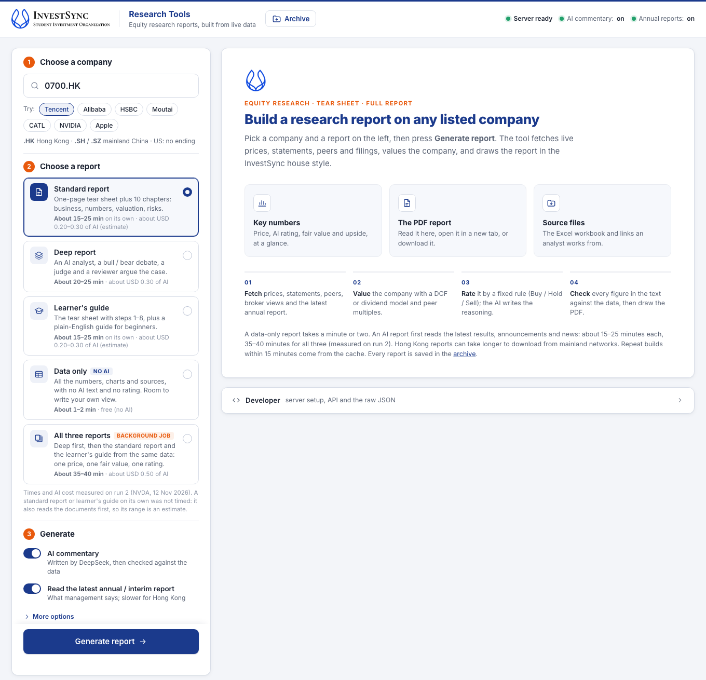
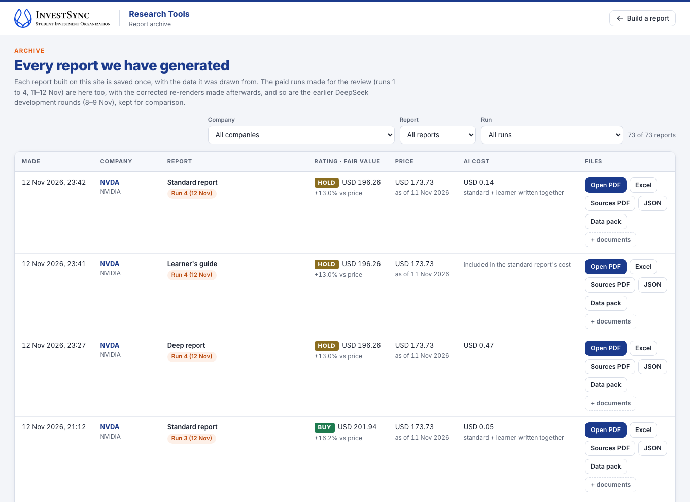
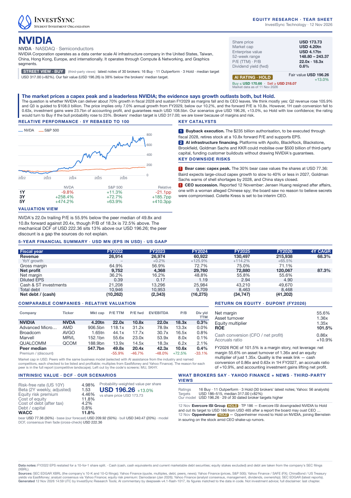
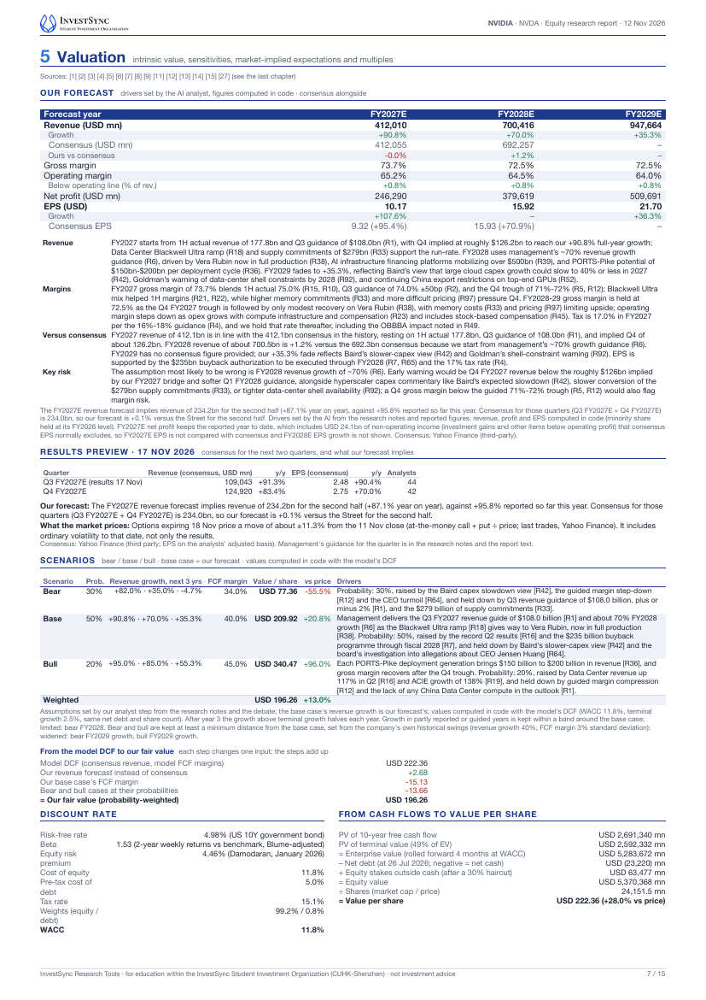
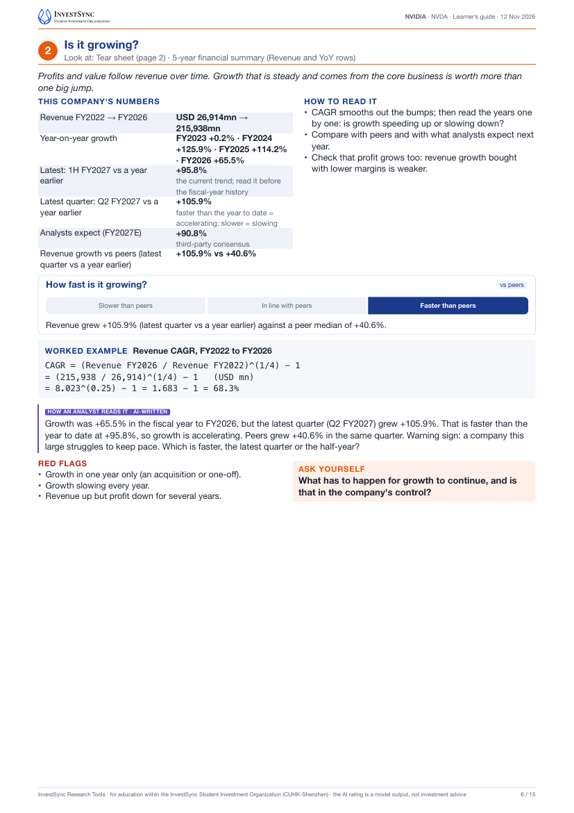
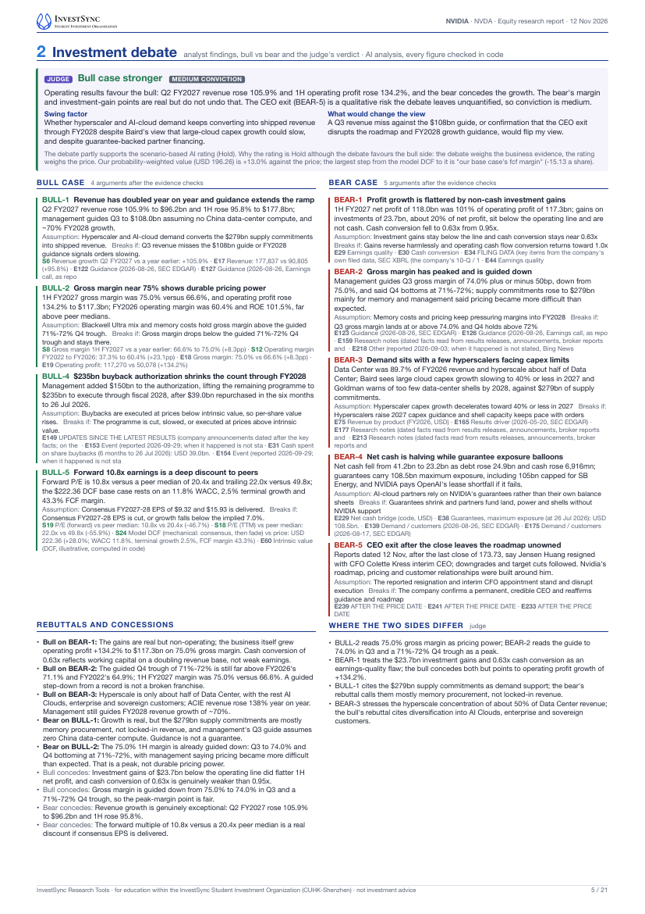
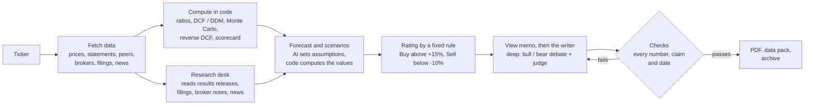

<p align="center">
  <picture>
    <source media="(prefers-color-scheme: dark)" srcset="https://raw.githubusercontent.com/investsync-cuhksz/.github/main/assets/investsync-logo-dark.png">
    
  </picture>
  &nbsp;&nbsp;&nbsp;&nbsp;
  <picture>
    <source media="(prefers-color-scheme: dark)" srcset="https://raw.githubusercontent.com/investsync-cuhksz/.github/main/assets/cuhksz-logo-dark.png">
    
  </picture>
</p>

# Research Tools

**Project #3 · InvestSync Technology**

Type a ticker, get an equity research report. Code computes every number. AI reads the latest results and news and
writes the analysis, then code checks every sentence it writes against the sources.

<p>
  
  
  
  <a href="LICENSE"></a>
</p>

<p align="center"></p>

> For education within the InvestSync student investment club. The rating is a model output, not investment advice.

## Contents

- [What it makes](#what-it-makes)
- [Examples](#examples)
- [How it works](#how-it-works)
- [How good is it?](#how-good-is-it)
- [Getting started](#getting-started)
- [Using it](#using-it)
- [Configuration](#configuration)
- [Project structure](#project-structure)
- [Documentation](#documentation)
- [Research partner kit](#research-partner-kit)
- [FAQ](#faq)
- [Contributing](#contributing)
- [License](#license)
- [Team](#team)

## What it makes

Pick a listed company in Hong Kong (`0700.HK`), mainland China (`600519.SH`, `300750.SZ`) or the US (`NVDA`) and
one of five reports:

| Report | What you get | Time | AI cost* |
|---|---|---|---|
| **Standard report** | A one-page tear sheet plus 10 chapters: business, financials, valuation, peers, news, risks, rating | 15–25 min | ~USD 0.20–0.30 |
| **Deep report** | The standard report plus an investment committee: an analyst, a bull and a bear who argue, a judge and a reviewer | 20–25 min | ~USD 0.30 |
| **Learner's guide** | The tear sheet plus 8 plain-English steps ("Is it growing?", "Is it cheap?"), each with a worked example and a coach's note | 15–25 min | ~USD 0.20–0.30 |
| **Data only** | Every number, chart and source, with no AI text and no rating, and boxes to write your own view | 1–2 min | free |
| **All three** | Deep, standard and learner's guide from the same data (one price, one fair value, one rating), as a background job | 35–40 min | ~USD 0.50 |

\*Measured on NVIDIA in November 2026 with the default models. An AI report spends most of its time reading the
latest results documents and news.

Every report comes with:

- **A source data pack**: an Excel workbook (statements, ratios, valuation workings, a live DCF you can edit,
  peers, prices, broker views, the evidence behind each research note), a sources PDF with every link, and the JSON.
- **An archive entry**: every report is saved with its data and listed on the archive page. This repository ships
  with the archive of every report made during development, so you can browse real outputs before you set anything
  up.
- **Citations**: every research note in the text has an id ([R12]) that leads to the exact words in its source.

<p align="center"></p>

## Examples

Real pages from the NVIDIA reports of 12 November 2026 (run 4). The full PDFs are in the archive:
[standard](output/archive/2026-11-12_225950_NVDA_standard_run4/NVDA_standard.pdf), [learner's guide](output/archive/2026-11-12_225950_NVDA_learner_run4/NVDA_learner.pdf), [deep](output/archive/2026-11-12_225950_NVDA_deep_run4/NVDA_deep.pdf), each with its [source data pack](output/archive/2026-11-12_225950_NVDA_standard_run4/NVDA_standard_datapack.zip).

| Tear sheet (page 1) | Valuation |
|---|---|
|  |  |
| **Learner's guide** | **Deep report: the debate** |
|  |  |

## How it works



Three house rules make the reports checkable:

1. **Code does the numbers.** Statements, ratios, the DCF, the scenario values and the rating are computed in code.
   The AI never supplies a figure.
2. **The AI writes from evidence.** A research desk reads the latest results releases, filings, broker notes and
   news and turns them into dated, sourced notes, keeping each note's exact quote. The writer works from those
   notes, our forecast and the numbers.
3. **Code checks every sentence.** Every figure must match the data. Every claim must be supported by a source, and
   dates and attributions must follow fixed rules. A sentence that fails is sent back or removed.

Two AI models share the work: **DeepSeek V4.1 Flash** does the volume (reading, extracting, writing) and **Claude
Sonnet 5.5** does the judgement steps (scenarios, the view memo, the debate judge, the learner's coach). Both run
through OpenRouter, and any OpenAI-compatible model can be used instead.

More detail: [docs/METHODOLOGY.md](docs/METHODOLOGY.md) (data sources, valuation method, report anatomy) and the
engineer's guide (see [Documentation](#documentation)).

## How good is it?

We had three AI reviewers score our NVIDIA reports blind, side by side with reports that Claude Opus 5.5 wrote as
an agent with full research tools. Each reviewer checked figures against primary sources and scored 7 criteria out
of 10: accuracy, valuation, thesis, risk & balance, timeliness, communication and standards.

Scores out of 10, average of the two Claude Opus 5.5 reviewers (NVIDIA; learner's guide = its 5 criteria, scaled):

| Run (review round) | What changed | Standard | Deep | Learner's guide | AI cost, all three |
|---|---|---:|---:|---:|---:|
| Run 1 (R10, 11 Nov) | Claude Sonnet 5.5 at five judgement steps | 6.57 | 6.53 | 6.70 | USD 0.49 |
| Run 2 (R11, 12 Nov) | Code fact sweep on every sentence, call summaries, 10-year DCF | **7.09** | **7.12** | 7.40 | USD 0.50 |
| Run 3 (R12, 12 Nov) | Claude Opus 5.5 at four judgement steps | 6.92 | 7.09 | **7.60** | USD 0.87 |
| Run 4 (R13, 13 Nov) | Debate before the scenarios, the year that decides the value | 6.75 | 6.57 | **7.60** | USD 0.61 |
| Benchmark: Claude Opus 5.5 as an agent | 150–210 tool calls, ~55 min per company | 8.2–8.3 | 8.5–8.7 | 8.6–8.7 | ≈ USD 10–20 per company* |

\*The benchmark ran on a subscription; the figure is a rough conversion at API prices, not a bill.

Gemini, the third, non-Claude reviewer, scored run 4 at 8.1 / 8.2 / 8.4 against the benchmark's 9.2 / 9.4 / 9.5, a
gap of about 1.1 points, and found no verified error in either team.

What this means in plain words: the reports are accurate (reviewers verify the reported figures and find few errors
that change a conclusion), and cost well under a dollar for three reports. They still trail a top model working as a
full analyst by about 1.2–1.8 points, mostly on the depth of the thesis and the valuation. Run 2 remains the best
result; runs 3 and 4 tested a stronger model and a new order of steps and did not beat it.

Caveats:

- **One stock.** Every run was on NVIDIA, so the scores may not carry over to other companies.
- **Reviewer bias.** Two of the three reviewers are Claude Opus 5.5, the same model that wrote the comparison
  reports, so they may prefer its style. Gemini is the independent check.
- **AI reviewers, not people.** A human review by the club's finance team is still to come.
- **Run 4 reused run 3's research** from a cache (same day), so its new reading rules were not tested; the cache
  key is fixed. One reviewer found a stale fair value in run 4's deep report, a side effect of the new step order, also
  fixed in code.

The full story (every round, every error found, what was changed after each) is in the
[team briefing deck](#documentation).

## Getting started

### What you need

- **Python 3.11** (3.10+ works) and git
- **An API key** for the AI reports (not needed for data-only reports or the tests). The simplest option is one
  [OpenRouter](https://openrouter.ai) key, which covers both default models. A [DeepSeek](https://platform.deepseek.com)
  key on its own also works.
- Optional: a free [Finnhub](https://finnhub.io) key for older US news.

### Install

```bash
git clone https://github.com/investsync-cuhksz/research-tools.git
cd research-tools
python3.11 -m venv .venv
source .venv/bin/activate            # Windows: .venv\Scripts\activate
pip install -r requirements.txt
# slow connection in mainland China? use a mirror:
# pip install -r requirements.txt -i https://mirrors.aliyun.com/pypi/simple/
```

### Add your API keys

Your keys stay on your computer: `.env` and `secrets/` are both git-ignored. Use **one** of these two ways.

**Option A: a `.env` file**

```bash
cp .env.example .env
```

Then edit `.env`:

```env
# OpenRouter (recommended: one key for DeepSeek and Claude)
OPENROUTER_API_KEY=sk-or-...
LLM_MODEL=openrouter/deepseek/deepseek-v4.1-flash-1017

# or DeepSeek directly
# LLM_BASE_URL=https://api.deepseek.com
# LLM_MODEL=deepseek-flash
# LLM_API_KEY=sk-...

# optional
FINNHUB_API_KEY=...
```

**Option B: key files**, each holding just the key:

```text
secrets/openrouter.txt     OpenRouter
secrets/deepseek.txt       DeepSeek (direct)
secrets/finnhub.txt        Finnhub (optional)
```

A variable in `.env` or your shell wins over a key file. Check what the app sees with
`curl http://localhost:8000/v1/status` once it is running. It shows which models are set up, never the keys.

> Never commit a key. If one leaks, revoke it on the provider's site and make a new one.

### Run it

```bash
tools/serve.sh          # the web app with the tested model settings, at http://localhost:8000
```

Open <http://localhost:8000>, pick a company and a report, and press **Generate report**. The archive is at
<http://localhost:8000/archive>.

`tools/serve.sh` uses OpenRouter (DeepSeek V4.1 Flash plus Claude Sonnet 5.5 for the judgement steps). With a DeepSeek
key only, or no key yet, start the server directly and it uses whatever `.env` says:

```bash
uvicorn api.main:app --port 8000     # no key: choose "Data only", or switch off "AI commentary"
```

### Check the install

```bash
LITELLM_LOCAL_MODEL_COST_MAP=True pytest -q     # about 542 tests, offline, no key needed, ~1–2 min
```

## Using it

### Web app

| Page | What it does |
|---|---|
| `/` | Build a report: company, report type, options |
| `/archive` | Every report built so far, filterable, with PDF, Excel, sources, JSON and the data pack |
| `/docs` | The API, interactive |

The **All three reports** job runs in the background (one at a time) and asks before it starts, because it is the
expensive option.

### Command line

```bash
python generate.py --ticker 0700.HK                          # standard report -> output/
python generate.py --ticker NVDA --no-ai                     # data only (free)
python generate.py --ticker 0700.HK --layout learner         # learner's guide
python generate.py --ticker 0700.HK --mode deep              # deep report (debate, judge, reviewer)
python generate.py --ticker 0700.HK --layout tearsheet       # page 1 only
python generate.py --ticker 0700.HK --datapack out.zip       # + source data pack (add --datapack-docs for filings)
python generate.py --batch covered_tickers.txt --output-dir output/   # a whole list
python generate.py --from-json saved.json                    # re-render a saved report, free
```

### API

| Endpoint | Returns |
|---|---|
| `GET /v1/tearsheets/{ticker}` | The report data as JSON (`?ai=`, `mode=single\|two_step\|deep`, `filings=`, `learner=`, `data_only=`) |
| `GET /v1/tearsheets/{ticker}/pdf` | The PDF (`?layout=report\|tearsheet\|learner\|data`) |
| `GET /v1/tearsheets/{ticker}/datapack` | The source data pack (ZIP; `?docs=true` adds the filings) |
| `POST /v1/runs` `{"ticker": "NVDA"}` | All three reports as a background job; `GET /v1/runs/{id}` for progress and cost |
| `GET /v1/archive` | Every saved report; `/v1/archive/{id}/{file}` for one file |
| `GET /v1/status`, `GET /health` | Configured models; liveness |

### Docker

```bash
docker compose up -d --build       # serves on port 8000; put your keys in .env first
```

### Write the analysis with your own AI

[`skill/investsync-research-notes/`](skill/investsync-research-notes/) is a skill file any AI chat can follow
(DeepSeek, ChatGPT, Claude...). Give it a report's facts and it writes the standard report, the learner's guide or
the deep report under the same rules as our pipeline. Make the facts file from any saved report with:

```bash
python tools/exercise_pack.py output/archive/<entry>/<TICKER>_standard.json
```

## Configuration

Most settings have sensible defaults. The ones you are most likely to change:

| Setting | Default | What it does |
|---|---|---|
| `LLM_MODEL` | DeepSeek V4.1 Flash | The main model (reading, writing, checking) |
| `LLM_JUDGE_MODEL` | Claude Sonnet 5.5 (`tools/serve.sh`) | The judgement steps: scenarios, view memo, judge |
| `LLM_FALLBACK_*` | none | A backup OpenAI-compatible model if the main one fails |
| `RESEARCH`, `RESEARCH_CHUNKS` | on, 60 (70 in `serve.sh`) | The research desk, and how many document excerpts it reads |
| `NEWS_ALLOWLIST` | on | Keep news only from the outlets in `config/news_sources.json` |
| `FILINGS_ENABLED` | on | Read the latest annual / interim report |
| `INVESTSYNC_ARCHIVE` | on | Save every report to `output/archive/` |

Every setting is listed with a comment in [`.env.example`](.env.example). The finance team owns these files:

| File | What it holds |
|---|---|
| `config/valuation.json` | Equity risk premium, terminal growth, tax rates, when a DCF is withheld |
| `config/rating.json` | Rating thresholds and the overall-view weights |
| `config/peers.json` | Curated peer lists, e.g. `{"0700.HK": ["9988.HK", "3690.HK", ...]}` |
| `config/news_sources.json` | The news outlets reports may use |
| `investsync/narrative/playbooks/*.md` | Per-sector notes on what an analyst checks |

## Project structure

```text
research-tools/
├── api/                    web app and API (FastAPI) + the web pages (api/static/)
├── investsync/
│   ├── data/               data sources: prices, statements, filings, brokers, news
│   ├── quant/              ratios, valuation (DCF, DDM, Monte Carlo), rating, scorecard
│   ├── research/           the research desk (reads documents, writes sourced notes)
│   ├── narrative/          AI steps (forecast, scenarios, writer, debate, learner coach) and their checks
│   ├── render/             PDF templates (Typst), charts, the learner's guide
│   ├── archive.py          the report archive
│   └── datapack.py         the source data pack (Excel, sources, JSON)
├── config/                 finance settings (valuation, rating, peers, news sources)
├── skill/                  the skill file for writing reports with your own AI
├── research-partner-kit/   tasks and files for the club's research partner
├── tools/                  serve.sh, cost split, exercise pack, probes
├── tests/  fixtures/       offline tests and saved data
├── output/archive/         every report made so far (PDF, JSON, data pack)
├── docs/                   methodology and images
└── generate.py             command line
```

## Documentation

| Document | What it covers |
|---|---|
| [docs/METHODOLOGY.md](docs/METHODOLOGY.md) | Data sources per market, valuation method, the anatomy of the report, the research behind the design |
| [Engineer's guide](https://claude.ai/artifact/85dqKn58Tf3qjjft3pMRSs) | A guided tour of the pipeline: one question per chapter, one real example each |
| [Team briefing deck](https://claude.ai/artifact/G58C5XQDi2ZvYxhoidL8A1) | The project in 29 slides: the reports, how they are built, every review round, costs, next steps |
| [Full presentation archive](https://claude.ai/artifact/Gp3fumsbHixhwGt8ySLtgM) | The long version (75+ slides) with every round's details |
| [CONTRIBUTING.md](CONTRIBUTING.md) | How to set up, propose a change and the house rules for the code |

## Research partner kit

[`research-partner-kit/`](research-partner-kit/) holds the tasks for the club's research partner and everything
they need:

1. Make an NVIDIA report with free AI accounts from your own prompts, and review it against ours.
2. Do the same with our facts and our skill file, to see how much the pipeline adds beyond the numbers.
3. Build a weekly watchlist sheet for the club.

## FAQ

<details>
<summary><b>Do I need an API key?</b></summary>

Only for the AI reports. Data-only reports, the archive, the source data packs and the tests work without a key.
</details>

<details>
<summary><b>How much does a report cost?</b></summary>

About USD 0.20–0.30 for a standard report or learner's guide, USD 0.30 for a deep report and USD 0.50 for all
three, measured on NVIDIA with the default models. Data-only reports are free. The job page shows the actual cost of
each run.
</details>

<details>
<summary><b>Is the rating investment advice?</b></summary>

No. The rating is a model output, set by a fixed rule: Buy when our fair value is more than 15% above the price,
Sell when it is more than 10% below, Hold in between. The reports are for learning how equity research works.
</details>

<details>
<summary><b>Can the AI make up numbers?</b></summary>

It is not allowed to, and code checks for it. Every figure in the AI text must match the data. Every claim must be
supported by a quoted source, and a sentence that fails is rewritten or removed. Reviewers still find occasional
errors, mostly in wording or dating rather than figures.
</details>

<details>
<summary><b>Why does an AI report take 15–25 minutes?</b></summary>

Most of the time goes to reading: the research desk downloads the latest results release, filings and up to 100+
document excerpts and news items, and pulls dated facts out of them. Writing and checking take a few minutes more.
A data-only report takes 1–2 minutes.
</details>

<details>
<summary><b>Which markets and companies work?</b></summary>

Listed companies in Hong Kong (`.HK`), Shanghai (`.SH`), Shenzhen (`.SZ`) and the US (no suffix). Banks and insurers
are valued with a dividend discount model instead of a DCF. Sector playbooks currently cover banks, batteries and
EVs, consumer staples, hardware, internet platforms and semiconductors, plus a general one.
</details>

<details>
<summary><b>Can I use a different AI model?</b></summary>

Yes. Any OpenAI-compatible API works: set `LLM_MODEL` (and `LLM_BASE_URL`, `LLM_API_KEY`) in `.env`. Through
OpenRouter, use a model id such as `openrouter/<provider>/<model>`. The judgement steps can use a stronger model via
`LLM_JUDGE_MODEL`. Quality was measured with the defaults only.
</details>

<details>
<summary><b>Downloads are slow or fail in mainland China. What can I do?</b></summary>

Use a PyPI mirror for the install (see Install). Hong Kong filings from HKEXnews can take minutes on mainland networks.
They download in the background, are cached for 30 days, and the report is built without them if they are not ready
yet. Prices fall back to Yahoo Finance if Sina is unreachable.
</details>

<details>
<summary><b>A report says something was "not found in the documents read". Is that an error?</b></summary>

No. The research desk reads a limited number of document excerpts, so the report says what it did not find rather
than claiming the company never disclosed it.
</details>

<details>
<summary><b>Where do the numbers come from?</b></summary>

Free public sources: company filings (SEC EDGAR, HKEXnews, CNINFO), EastMoney, Sina Finance and Yahoo Finance for
market data, statements and broker views, and news from an allowlist of outlets. Each report's sources PDF lists
every link. Details per market are in [docs/METHODOLOGY.md](docs/METHODOLOGY.md).
</details>

<details>
<summary><b>How were the quality scores measured?</b></summary>

Blind reviews: the reviewers got our reports and Claude Opus 5.5's reports under team letters, with a fixed brief.
They had to check at least 12 key figures against primary sources, quote the exact words before logging an error,
and score 7 criteria.
</details>

## Contributing

Contributions are welcome, from finance students and developers alike. Read [CONTRIBUTING.md](CONTRIBUTING.md) for
setup, the pull-request flow and the house rules (code computes every number, every AI sentence is checked, no
secrets in git). Good first contributions: review a report and log its errors, improve a sector playbook, curate
peer lists, add a test.

## License

[MIT](LICENSE) for the code. Some third-party material keeps its own licence: the scorecard adapts Simply Wall St's
Company Analysis Model (CC BY-NC-SA 4.0), the world map is from Natural Earth (public domain), and the logos belong
to their owners. Archived reports quote third-party data with sources. See [LICENSE](LICENSE).

## Team

- Birlik Yessen, research partner
- Karel Hutajulu ([@karelhutajulu](https://github.com/karelhutajulu)), CTO

Built with [FinRobot](https://github.com/AI4Finance-Foundation/FinRobot)'s ideas,
[DSPy](https://github.com/stanfordnlp/dspy), [Typst](https://github.com/typst/typst),
[AKShare](https://github.com/akfamily/akshare) and [yfinance](https://github.com/ranaroussi/yfinance).
